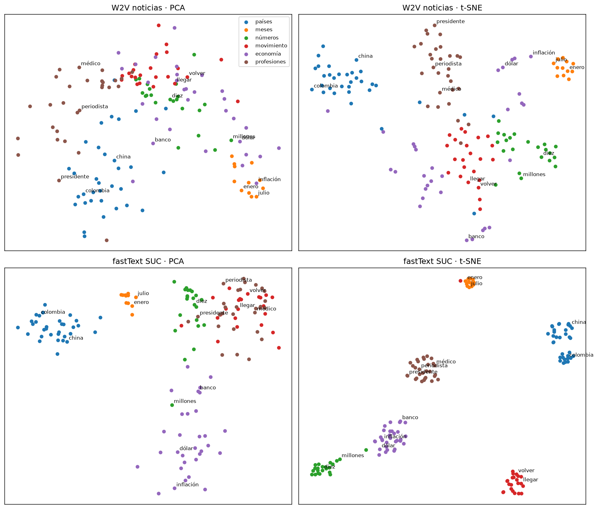

# Laboratorio #9 — Embeddings

Natural Language Processing · Milton Beltrán

En este laboratorio entrenamos embeddings de palabras sobre el corpus de noticias y sobre el Quijote, primero contando co-ocurrencias (PPMI y SVD) y después con Word2Vec y FastText, y los comparamos contra los vectores preentrenados fastText SUC. Al final los usamos para clasificar noticias con PyTorch y para una búsqueda semántica. El código completo está en `lab9.ipynb`.

<strong>Corpus:</strong> noticias, 1,142 documentos · 20,909 oraciones · 605,523 tokens · 30,750 tipos. Quijote, 126 capítulos · 10,585 oraciones · 378,666 tokens · 22,842 tipos. <strong>Preentrenados:</strong> fastText SUC M, 100 dimensiones, 200,000 palabras cargadas.

## 1. Preparación de los corpus

Word2vec aprende de ventanas de vecinos, entonces el texto se prepara como una lista de oraciones con los tokens en orden. Esto invierte lo que hacíamos en los labs #1 a #4. Las stopwords se quedan, porque si se borran palabras que estaban a cinco posiciones quedan pegadas y la ventana arma vecinos falsos. Tampoco hay stemming, porque "gobiernos" y "gobernó" quedarían en `gobern` y se perdería el número y el tiempo verbal que después se evalúan en las analogías.

La normalización quedó en minúsculas, sin puntuación, con tildes y con números. Revisamos SUC y ninguna de sus 200,000 palabras tiene mayúscula, así que pasar a minúsculas es obligatorio. Las tildes sí cuentan, "españa" está en la posición 541 y "espana" en la 67,448, y SUC tampoco usa punto de miles. Las noticias necesitaron tres arreglos, párrafos pegados sin espacio como "imaginamos.Para" (6,147 casos), "EE.UU." partiendo oraciones y el separador de miles.

| min_count | Vocab. noticias | % tokens fuera | Vocab. Quijote | % tokens fuera |
|---|---|---|---|---|
| 1 | 30,750 | 0.00 | 22,842 | 0.00 |
| 2 | 16,832 | 2.30 | 11,690 | 2.95 |
| 5 | 8,595 | 5.91 | 5,275 | 7.40 |

Con `min_count = 2` el vocabulario baja casi a la mitad perdiendo solo el 2.3% de los tokens, porque el 45% de las palabras aparece una sola vez. Los pares skip-gram los generamos con código propio. La oración "nunca pensé que pudiera trabajar en un banco" da 26 pares con ventana 2, y el corpus completo 2,296,962 con ventana 2 y 5,433,568 con ventana 5, casi 4 y 9 pares por token. Cada par es un ejemplo cuya "etiqueta" es la palabra vecina, que ya viene en el texto, por eso word2vec no necesita datos etiquetados.

## 2. Co-ocurrencia, PPMI y SVD

La matriz de co-ocurrencia de las 2,000 palabras más frecuentes (ventana ±2) tiene 93.78% de ceros, menos que el 98.71% de la BoW del Lab #2 solo porque dejamos las palabras frecuentes. Con conteos crudos los vecinos de "empresa" y "gobierno" son la, de, una, que, en, o sea stopwords, y casi cualquier par de sustantivos se parece ("tecnología / presidente" da 0.671, más que "banco / financiera" con 0.362).

PPMI, implementado con NumPy, compara lo observado contra lo esperado por azar y saca a las stopwords. Los vecinos pasan a ser telecomunicaciones, especializada y líder para empresa, y federal, funcionarios, petro y duque para gobierno. Los cosenos bajan pero el orden tiene más sentido, los pares sin relación quedan al fondo. Después reducimos con TruncatedSVD a 100 dimensiones (25% de varianza), que es nuestro primer modelo de embeddings, y los vecinos de "empresa" ya son compañía, plataforma, entidad y tecnología. PPMI resuelve el dominio de las palabras frecuentes y SVD la dispersión, juntando contextos parecidos en la misma dirección.

## 3. Investigación

**CBOW y skip-gram.** CBOW promedia el contexto para predecir la palabra central y skip-gram predice el contexto desde la central. CBOW es más rápido pero diluye las palabras raras, y skip-gram genera pares propios por cada aparición, por lo tanto funciona mejor con palabras poco frecuentes.

**Negative sampling.** Un softmax normaliza sobre todo el vocabulario en cada par. Negative sampling lo cambia por clasificaciones binarias del par real contra *k* palabras al azar, con P(real | w, c) = σ(v_w · c_c), donde v_w es el vector de la palabra central y c_c el de la palabra de contexto. Se usan dos tablas porque con una sola el producto de una palabra consigo misma siempre sería alto, y al final se conserva la de palabras.

**word2vec, GloVe y fastText.** Word2vec es predictivo y local, GloVe factoriza la matriz global de co-ocurrencias y fastText suma n-gramas de caracteres, lo que le permite armar vectores para palabras nunca vistas, algo muy útil en español por la cantidad de conjugaciones.

**gensim y PyTorch.** `vector_size` es la dimensión, `window` el contexto a cada lado, `min_count` la frecuencia mínima, `sg` elige skip-gram o CBOW, `negative` cuántas negativas por par, `sample` descarta palabras muy frecuentes y `epochs` las pasadas. `nn.Embedding` es una tabla entrenable (con `padding_idx` en cero), `from_pretrained` la carga con vectores ya entrenados y `freeze` decide si se ajustan, y `nn.EmbeddingBag` busca y promedia los vectores de un documento en un paso. Multiplicar un one-hot por E selecciona una fila porque todo lo demás se multiplica por cero.

## 4. Word2Vec y fastText

El modelo base (skip-gram, ventana 5, 100 dimensiones, `min_count = 2`, 10 épocas) tarda unos 9 segundos. Lo entrenamos con un solo hilo para que sea reproducible. CBOW es el peor, para "banco" da cordillera, grupo y equipo. Con ventana 2 los vecinos son palabras que ocupan el mismo lugar en la oración (banco con popular, bce, gnb, scotiabank), y con ventana 10 aparecen palabras del mismo tema (gobierno con biden, ministerio, detalló). Otras formas de la misma palabra casi no aparecen, no hay suficientes ejemplos.

El mismo modelo sobre el Quijote cambia todo. "señor" pasa de ruido en las noticias a un tratamiento (álvaro, tarfe, perdóneme), "casa" queda con aldea y hacienda y "caballo", que ni existe en las noticias, queda con freno y carro. El significado viene del corpus. FastText arma vectores para palabras que no vio. "criptoempresa" queda cerca de empresa y criptomoneda e "invirtiéramos" cerca de invitamos y aspiramos, mientras Word2Vec da `KeyError`. Elegimos el base como mejor modelo, igual de bueno que el de 300 dimensiones, en la mitad del tiempo y con la misma dimensión que SUC.

## 5. Similitud, vecinos y analogías

Nuestras funciones `coseno` y `analogia` dan lo mismo que gensim. Los antónimos salen con similitud alta en todos los modelos ("subir / bajar" 0.937 en SUC), porque aparecen en los mismos contextos. La similitud distribucional mide qué tan intercambiables son dos palabras, no si significan lo mismo.

| Modelo | Pares (de 20) | Spearman ρ | Analogías top 1 | Analogías top 5 |
|---|---|---|---|---|
| SVD-PPMI | 14 | 0.499 | 6% | 6% |
| W2V noticias | 19 | 0.342 | 6% | 11% |
| W2V Quijote | 7 | 0.393 | 6% | 11% |
| fastText SUC | 20 | **0.666** | **78%** | **94%** |

El conjunto propio tiene 20 pares puntuados de 0 a 10 en escala de relación (como WordSim-353). SUC es el único que se parece a nuestro juicio con significancia (p = 0.001). De 18 analogías en seis tipos SUC acierta 14 en primer lugar, y nuestros modelos casi ninguna, porque 600 mil tokens no alcanzan para que la diferencia entre vectores sea constante. Sin excluir las palabras de la consulta, nuestro Word2Vec devuelve primero una de ellas en 4 de 5 casos, así que el "≈" de rey − hombre + mujer no es una igualdad.

## 6. Visualización

Con 150 palabras en seis grupos, SUC forma seis islas limpias con t-SNE (silueta 0.418) y nuestro modelo separa países, meses y profesiones pero deja los términos económicos regados (silueta 0.206, economía −0.079). t-SNE conserva vecinos cercanos, por eso los grupos son confiables, pero la distancia entre islas es arbitraria.

## 7. Sesgos

En SUC las profesiones asociadas a hombres quedan más cerca de "hombre" (programador 0.225, ingeniero 0.193) y las asociadas a mujeres más cerca de "mujer" (secretaria −0.318, profesora −0.261). "hombre : jefe :: mujer : ?" da secretaria antes que jefa, y "mujer : enfermera :: hombre : ?" da doctor antes que enfermero. Nuestro modelo no muestra patrón porque "hombre" y "mujer" casi no aparecen en las noticias, no porque no tenga sesgo.

## 8. Clasificación y búsqueda

| Modelo | F1 macro (100 %) | Accuracy (10 %) | F1 macro (10 %) |
|---|---|---|---|
| TF-IDF + reg. logística | 0.690 | 0.404 | 0.160 |
| aleatoria, entrenable | 0.814 | 0.661 | 0.510 |
| W2V noticias, congelada | 0.763 | 0.719 | 0.605 |
| W2V noticias, fine-tuning | 0.814 | 0.719 | 0.660 |
| fastText SUC, congelada | 0.768 | 0.661 | 0.543 |
| fastText SUC, fine-tuning | **0.829** | 0.690 | 0.542 |

Con `EmbeddingBag` y las particiones del Lab #3, la accuracy con todos los datos queda pareja (0.81 a 0.84) pero en F1 macro los embeddings le ganan a TF-IDF por más de 0.07, y el fine-tuning supera a la tabla congelada. Con el 10% TF-IDF se cae a 0.404 y los vectores preentrenados son los que aguantan. En la búsqueda semántica SUC encuentra "mujeres empresarias" para la consulta "mujeres emprendedoras" sin compartir la palabra, cosa que TF-IDF no logra en primer lugar.

---

<strong>Repositorio:</strong> <a href="https://github.com/MrCifristo/NaturalLanguageProcessing">github.com/MrCifristo/NaturalLanguageProcessing</a> · Notebook: <code>lab9-nlp/lab9.ipynb</code>

